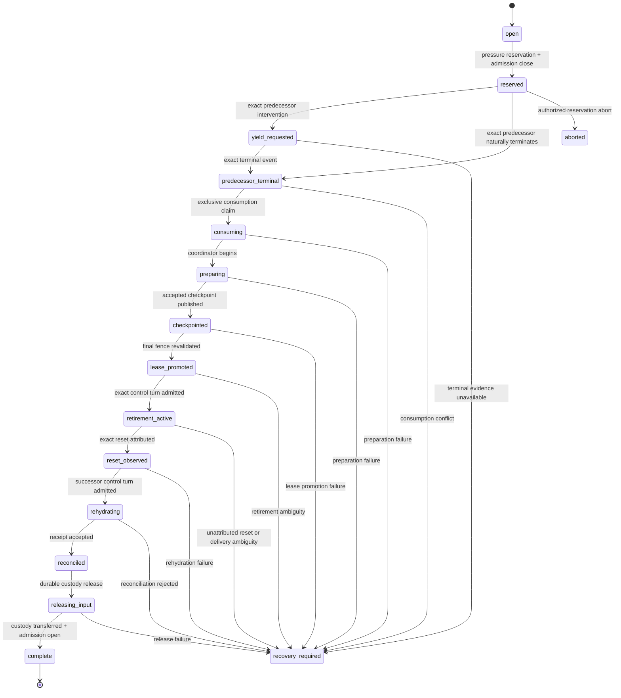

# Context Lifecycle Transition Protocol Redesign

## Status

This is the accepted design basis for the App Server context-lifecycle
transition protocol. It records a redesign boundary before implementation.
Design acceptance does not authorize source changes, implementation planning
execution, runtime activation, incident replay, campaign mutation, provider
entry, checkpointing, or publication.

The semantic owner remains
[`semantic-context-lifecycle-manager.md`](semantic-context-lifecycle-manager.md).
That document defines what continuation meaning must survive, how checkpoints
are compiled and verified, and what retirement and rehydration must establish.
This document defines the narrower control protocol that orders those
capabilities across an active domain turn, a provider context reset, and a
successor context.

```yaml
design_status: accepted
review_status: two_pass_review_complete_no_remaining_architectural_findings
acceptance_status: accepted_as_design_basis
acceptance_evidence: chatboard_sequence_632
implementation_authority: none
scope: context-transition orchestration only
status_as_of: 2026-09-22
```

## Architectural decision

Replace the current callback-distributed transition orchestration with one
durable, host-owned transition state machine.

The transition controller owns the continuity of one transition from pressure
reservation through predecessor termination, checkpoint preparation, leased
retirement, reset attribution, successor rehydration, queued-input release,
and terminal closure. Existing components continue to own their specialized
work, but they no longer infer global transition progress independently from
the order in which callbacks happen to arrive.

This is a bounded redesign, not a rewrite of the semantic lifecycle manager,
the provider adapter, pressure policy, checkpoint schema, transition-lease
authority, durable input custody, or role and campaign runtimes.

## Why a redesign is warranted

The live system has repeatedly failed at boundaries between individually
reasonable components. The failures are not concentrated in pressure
detection, semantic compilation, checkpoint contents, or lease validation.
They are concentrated in ownership transfer and event ordering:

- pressure can be observed before domain-turn completion;
- reservation and input fencing can succeed while lifecycle consumption still
  waits for a later completion callback;
- provider reset evidence can arrive before that callback advances the
  lifecycle;
- a successor context can exist before the predecessor's reservation has been
  consumed;
- duplicate observations, adapter initialization, failed post-turn work, and
  queue release have each required separate reconciliation behavior; and
- locally correct fail-closed checks then terminalize transitions whose global
  ordering was never made authoritative.

The most recent preserved incident makes the ownership gap explicit.

| Evidence | Observation |
|---|---|
| Chatboard sequence 607 | A reserved transition reset and terminalized as `unattributed_context_reset_after_reservation`. |
| Chatboard sequence 611 | A domain turn crossed an explicit reservation, the successor opened blank, and the transition failed before any lifecycle episode or checkpoint existed. |
| Chatboard sequence 627 | Preparation `sha256:e59a6ce9...` reserved successfully, reset produced a small successor context, but consumption `sha256:7a853705...` was first claimed only when the successor turn completed. The terminal lifecycle revision was `sha256:2857f2193a34b568d092ba0d6fe943ee1d93ec12bedc41ad0e3a9b902b74105d`. |

Sequence 627 was reproduced on runtime source
`07a6543945466e93b019261a9f1682705f65b1b7`. The related repair candidate
`6ad83740a6b60e8f31a59fd1991bd334f9dd84dc`, tree
`65fc8a480225cc1528ccc592697df394f74d30b4`, remains immutable and paused.
It is evidence, not an implementation base implicitly approved by this design
acceptance.

## Current protocol gap

The current live path divides one logical transition across several owners:

```text
active observation
  → scheduler reserves preparation
  → adapter requests turn interruption
  → adapter observes provider terminal/reset events
  → retained-role completion callback claims consumption
  → coordinator compiles, verifies, and publishes
  → lease runtime authorizes retirement
  → adapter observes reset
  → host rehydrates and releases admission
```

No durable object presently owns the complete ordering relationship among
those steps. In particular, requesting a controlled yield does not itself
claim lifecycle consumption. Consumption is claimed after
`waitForTurnCompletion` resolves in the retained-role completion path. A reset
or successor event can therefore become observable before the transition that
caused the yield has advanced.

The existing fail-closed result is correct once this ordering has occurred:
the host must not invent attribution after the fact. The missing property is a
protocol that prevents valid transition work from reaching that ambiguous
ordering in the first place.

## Desired outcomes

The redesign must make these outcomes mechanically distinguishable:

1. A domain turn completes normally with no lifecycle transition.
2. Pressure reserves a transition, the exact domain turn yields, and one
   lifecycle episode consumes the reservation.
3. Semantic preparation cannot complete and admission remains safely closed
   with attributable recovery evidence.
4. A published checkpoint and promoted lease authorize exactly one retirement
   control turn.
5. The provider reset is attributed to that lease before any successor domain
   work is admitted.
6. One successor rehydrates the exact checkpoint and only then receives queued
   domain input.
7. Duplicate, delayed, and reordered events converge on the same durable state
   without repeating semantic work or domain effects.
8. A genuinely unleased reset remains fail-closed and cannot be laundered into
   a successful transition.

The following states are invalid regardless of route:

- a reset attributed without a promoted lease and exact retirement identity;
- a successor domain turn admitted before accepted rehydration;
- two consumers for one pressure reservation or domain turn;
- one consumer spanning reservations from different canonical turns;
- a checkpoint or lease inferred from an attempted call;
- queued input released without an accepted reconciliation receipt;
- an abort or supersession that can later execute alongside the original
  queued input; or
- recovery that depends on callback arrival order not represented in durable
  state.

## Governing invariants

### One durable transition owner

For each logical role instance, at most one active protocol operation may own
admission: either one non-terminal context transition or one authorized
recovery operation. Only a non-terminal transition can own retirement
authority. Its durable record is the source of truth for transition progress.
In-memory objects and model context are caches or executors, never alternate
owners. A terminal failed transition may remain referenced by a closed
admission fence, but it has no mutable authority.

An authorized recovery operation is not a second transition. A role-level
admission-owner record must atomically transfer its owner reference from the
failed transition to one exact recovery operation before that operation can
act. The failed transition retains evidence but no mutable authority after the
transfer. Recovery receives only its explicitly granted operations; it does
not inherit checkpoint, lease, reset, input-release, or domain authority merely
because it is linked to the failed transition.

### Reservation precedes intervention

The host may request that an active domain turn yield only after the exact
transition identity, role binding, predecessor thread, predecessor turn, and
pressure evidence are durably reserved and domain admission is closed.

### Predecessor termination drives consumption

An exact, attributable terminal event for the reserved predecessor turn must
advance the transition to exclusive consumption. Consumption must not depend
on a later caller resuming the original `deliverTurn` stack, and it must not be
claimed by successor completion.

### Checkpoint and lease precede retirement

No provider context reset is authorized until semantic preparation has
produced an accepted published checkpoint and the exact transition lease has
been promoted. Preparation reservation alone never authorizes `new_context`.

### Reset attribution is exact

A reset is attributable only when it matches the promoted lease, retirement
control-turn identity, role binding, thread, and expected predecessor context.
An early, unmatched, or ambiguous reset fails closed and cannot be repaired by
retrospectively attaching it to a lease.

### Successor control is not successor domain work

After an attributed reset, the host may admit only the exact rehydration
control turn. Ordinary domain turns, tool effects, binding changes, and queued
input remain fenced until reconciliation is accepted.

### Events are replayable; effects are exactly once

The controller may observe the same event more than once. Applying it must be
idempotent under an immutable event identity. Each application attempt
separately carries an expected transition revision for compare-and-swap.
Semantic inference, checkpoint publication, retirement delivery, queued-input
delivery, and domain effects require their own durable effect identities and
must not be repeated merely because an event is replayed.

### Intent is not provider entry

Recording retirement intent or entering `retirement_active` proves only that
the controller claimed an effect identity and may attempt the exact retirement
delivery. It does not prove that the provider received, accepted, began, or
completed that effect. Reset attribution that depends on provider entry must
use separately retained delivery evidence. Missing evidence remains ambiguous
rather than being inferred from transition state.

### Failure preserves authority boundaries

Failure may close admission, require human recovery, or prove that a
transition cannot continue. It does not create abort authority, supersession
authority, permission to replay input, or permission to bypass a lease.

## Proposed durable identity

Every transition should have an immutable identity allocated with its initial
reservation:

```text
transitionId
logicalRoleInstanceId
bindingRevision
threadId
predecessorTurnId
predecessorContextWindowId, when observable
reservationRevision
triggeringObservationIdentity
triggeringObservationSequence
pressureDisposition
createdAt
```

External observations, transition-relative classifications, and reducer
applications have separate identities.

A provider observation records an external fact without assigning it to a
transition:

```text
providerObservationId = digest(
  providerEventKind,
  providerThreadId,
  providerTurnId,
  providerEventIdentity,
  rawEvidenceRevision
)
```

`rawEvidenceRevision` identifies the immutable provider-source record. When the
provider supplies a stable native event identity, the source record binds it
and the exact retained raw bytes. Otherwise the host assigns an immutable
content digest bound to stable source coordinates at first ingestion. Database
row revisions, persistence timestamps, normalization revisions, and projection
revisions are not `rawEvidenceRevision`. Re-persisting, normalizing, or
reprojecting the same source record must reference the same
`providerObservationId`.

A transition event binds or classifies that immutable observation relative to
one transition:

```text
transitionEventId = digest(
  transitionId,
  transitionEventKind,
  providerObservationId or hostFactIdentity,
  classificationBasisRevision
)
```

`classificationBasisRevision` identifies an immutable classification-basis
artifact: the exact provider-observation or host-fact identities admitted as
evidence together with the classification rule-set/schema revision. It is not
the mutable transition revision used for reducer compare-and-swap. If the
evidence set or classification rules change, the controller creates a new,
linked transition event; a transition-state race alone does not change
`classificationBasisRevision` or `transitionEventId`.

The attempt to apply `transitionEventId` carries an expected transition
revision for compare-and-swap. That expected revision belongs to the reducer
application, not to the external fact or transition event. Losing a CAS race
does not make either identity false: the caller reloads the new transition
revision and reclassifies the event as applicable, replayed, deferred,
superseded, or semantically conflicting.

Changing `expectedTransitionRevision` never changes `transitionEventId`. A
successful application produces a new committed transition revision:

```text
immutable provider/host fact
  → immutable transition-relative classification
  → application attempt against expectedTransitionRevision
  → committedTransitionRevision
```

Timestamps may be evidence, but must not be the sole identity of an observation
or event. Repeated projections of the same provider observation must remain
byte-stable or be explicitly classified as a later observation, never
accidentally become conflicting records because a projection generated a new
timestamp.

## Proposed state machine

The names below describe semantic states, not required class names or database
enum spellings.



`open` is the absence of a non-terminal transition, not necessarily a stored
row. `complete`, `aborted`, and `recovery_required` retain durable evidence and
are terminal with respect to automatic protocol advancement. Recovery may
create an explicitly linked successor recovery operation; it must not mutate
history to make the failed transition appear successful.

### State-entry effects

State entry and its required durable effect claim must be atomic where a crash
between them could create duplicate authority. External effects that cannot be
atomic with SQLite use an outbox-style durable intent and an attributable
completion record.

| State | Required durable consequence |
|---|---|
| `reserved` | Close domain admission and persist exact predecessor identity. |
| `yield_requested` | Claim one idempotent intervention intent before sending the interrupt. |
| `predecessor_terminal` | Persist the exact terminal evidence independently of a waiting caller. |
| `consuming` | Claim the reservation once for one transition. |
| `preparing` | Claim the lifecycle episode/effect identity before inference. |
| `checkpointed` | Bind the accepted checkpoint and publication-ledger revision. |
| `lease_promoted` | Bind the promoted lease and exact retirement control identity. |
| `retirement_active` | Record delivery intent before `turn/start`; provider entry remains separately evidenced. |
| `reset_observed` | Bind a transition event referencing the immutable raw reset observation to the lease. |
| `rehydrating` | Record the exact successor challenge and control-turn identity. |
| `reconciled` | Bind the accepted receipt before release authority exists. |
| `releasing_input` | Advance custody one stable client-message identity at a time. |
| `complete` | Prove queue drain, reopen admission, and close the transition. |

## Component ownership after redesign

The redesign centralizes ordering authority without collapsing specialized
components into one class.

| Component | Owns | Must no longer own or infer |
|---|---|---|
| Pressure projector/controller | Deterministic pressure evidence and disposition | Transition progress or reset authority |
| Active-turn scheduler | Observation coalescing and reservation proposals | Global lifecycle state or completion-driven consumption |
| Transition controller | Durable state, event application, effect claims, admission mode, recovery classification | Semantic checkpoint contents or provider transport details |
| Provider adapter | Transport requests and normalized attributable provider events | Whether a reset is semantically valid or whether admission may reopen |
| Lifecycle coordinator | Attestation, projection, compilation, verification, and checkpoint publication | When its work is globally consumed or when a successor may run |
| Transition-lease runtime | Final fence validation and retirement authority | Pressure policy or recovery from unrelated callbacks |
| Input-custody runtime | Ordered durable queue and per-item delivery receipts | Whether reconciliation has granted release authority |
| Retained-role runtime | Domain delivery and terminal result projection | Orchestration of the entire transition inside a domain-turn completion callback |

The transition controller should consume events from these components through
small commands with explicit expected revisions. It should not reach into
their private in-memory state to reconstruct protocol truth.

## Turn and admission model

Admission must distinguish control traffic from domain traffic.

| Transition phase | Existing domain turn | New domain turn | Retirement control | Rehydration control | Tool/binding effects |
|---|---:|---:|---:|---:|---:|
| `open` | allowed | allowed | denied | denied | allowed |
| `reserved` / `yield_requested` | exact predecessor may only terminate | queued | denied | denied | denied or revoking, as contract requires |
| `predecessor_terminal` through `checkpointed` | terminal only | queued | denied | denied | denied |
| `lease_promoted` / `retirement_active` | terminal only | queued | exact bound turn only | denied | denied |
| `reset_observed` / `rehydrating` | retired | queued | denied | exact bound turn only | denied |
| `reconciled` / `releasing_input` | retired | durable custody transfer only; execution denied | denied | denied | binding changes remain fenced until transfer |
| `complete` | retired | allowed | denied | denied | allowed |
| `recovery_required` | no automatic action | queued | denied | only separately authorized recovery route | denied by default |

An App Server thread existing after reset does not imply that it is open for
domain input. Provider ability and Work Engine admission authority remain
separate facts.

## Event processing contract

All lifecycle-relevant provider notifications should first be persisted as raw
provider observations. Host completions should be persisted as host facts.
Transition-relative bindings of those observations or facts become durable
transition events before reducer decisions use them.

The controller applies an event with these outcomes:

- `applied`: it advanced the expected transition revision;
- `replayed`: the identical event was already applied;
- `deferred`: the event is valid but awaits an earlier durable state;
- `superseded`: the event belongs to an older observation or completed effect
  and adds no authority;
- `conflicting`: the event is semantically incompatible with the transition's
  immutable identity or established history; or
- `recovery_required`: the event proves an invalid or ambiguous state.

Storage application separately returns `committed`, `already_committed`, or
`revision_conflict`. A `revision_conflict` is a concurrency outcome, not a
semantic event disposition. The caller reloads the winning revision and asks
the reducer to classify the same immutable event again. Benign competing
workers therefore cannot create semantic rejection evidence merely by losing
a compare-and-swap race.

Deferral is bounded. An event cannot remain indefinitely in memory waiting for
another callback. Deferred events are durable and reconsidered after every
relevant state advance and process restart. If required predecessor evidence
cannot be established, the controller terminalizes with explicit recovery
evidence.

### Controlled yield

`turn/interrupt` acknowledgement is not predecessor termination. The adapter
must emit a separate exact terminal event when the reserved turn becomes
terminal. That event advances `yield_requested → predecessor_terminal` and
allows the controller to claim consumption without waiting for a later domain
API call to resume.

If exact predecessor-terminal evidence arrives while the transition is still
`reserved`, the reducer advances directly to `predecessor_terminal`. It does
not manufacture `yield_requested` or send an interrupt to a turn already known
to be terminal. The durable effect history therefore distinguishes natural
termination from host-requested intervention.

If the interrupt request is rejected because the exact turn is already
terminal, the adapter must recover and emit the attributable terminal outcome
or report that it cannot establish one. It must not discard the reservation.

### Reset observation

A compaction/reset notification may arrive early, more than once, or before a
turn-terminal notification. Its raw provider observation is recorded
immediately without a transition assignment. It is attributed only when the
current state and exact lease/turn identities permit
`retirement_active → reset_observed`.

An early reset before `lease_promoted` is not deferred into eventual success.
It proves an unleased reset and requires recovery. A matching reset observed
after retirement delivery but before another expected notification may be
durably deferred until the associated delivery evidence is resolved.

### Successor appearance

Successor context-window evidence may be recorded before the control plane has
finished classifying the reset. It grants no domain admission. Only the exact
rehydration command bound to the transition may use that successor until an
accepted receipt advances the transition.

## Restart and recovery semantics

Initialization order must not determine whether recovery is possible.

On startup, the host should:

1. initialize durable stores and the provider adapter;
2. load every non-terminal transition, every terminal transition still named
   by a closed admission-owner record, every active recovery operation, and
   their unapplied or deferred events;
3. reconstruct admission modes from the durable admission owner and referenced
   protocol state;
4. reconcile outstanding effect intents against provider and custody evidence;
5. advance transitions whose next state is mechanically established; and
6. expose domain admission only for roles proven `open` or `complete` with
   lifecycle custody drained or durably transferred to the domain scheduler.

Recovery commands that require the adapter must not execute before adapter
initialization. Conversely, adapter initialization must not silently admit a
role whose durable lifecycle state is fenced.

For an external effect with an intent but no completion record, recovery must
classify the effect as one of:

- definitely not entered and safe to issue once;
- definitely completed and safe to record without replay;
- still executing and safe only to observe; or
- ambiguous and therefore `recovery_required`.

No generic retry category is sufficient for provider reset, inference,
checkpoint publication, queued input, or domain effects.

### Recovery authority transfer

`recovery_required` ends automatic advancement and removes mutable transition
authority, but it does not by itself reopen admission. The durable role-level
admission owner remains fenced to the failed transition until an authorized
recovery command atomically:

1. names the exact failed transition and terminal revision;
2. records the human or owning-contract authority for the recovery scope;
3. allocates one linked `recoveryOperationId`;
4. changes the admission-owner reference from the failed transition to that
   recovery operation with compare-and-swap; and
5. records the exact operations the recovery owner may perform.

Only one active recovery operation may own that reference. It cannot inherit a
lease, attribute an earlier reset, release queued input, or replay an effect
unless those operations are separately established and included in its grant.
Completion returns admission ownership either to `open`, to one newly reserved
transition, or to another explicitly authorized terminal fence. This authority
transfer is part of design acceptance, not an implementation detail.

Transfer to `open` is legal only after every queued-input identity has a proven
non-ambiguous custody disposition. Each item must be durably accepted by the
domain scheduler, explicitly superseded or withdrawn under sufficient
authority, or otherwise reach a terminal custody result defined by the owning
contract. Merely leaving an item in lifecycle custody is safe from duplication
but is not sufficient to reopen admission. If custody must remain pending, the
recovery operation transfers both the admission-owner reference and the exact
custody responsibility to a newly reserved transition or an explicitly
authorized closed fence.

## Abortion, supersession, and queued input

Aborting a transition and releasing its queued input are separate operations.
The accepted reducer contract permits abort only from `reserved`, before
predecessor intervention, consumption, semantic preparation, checkpoint
publication, or lease authority begins. The authority-bearing command names
the exact transition revision and records why the transition will not advance
and what admission state follows. Later states enter `recovery_required` or
continue the protocol; they do not reuse abort as an unproven cancellation
mechanism.

If a queued input identity might still be delivered by an existing effect
intent, an abort must not release or duplicate it. The controller must first
establish that the original delivery is definitely absent or authoritatively
superseded. Supersession preserves a durable link from the original identity
to the replacement disposition.

A transition after attributed reset cannot be aborted back to the predecessor.
It can only reconcile, enter recovery, or be followed by an explicitly
authorized recovery operation.

`releasing_input` transfers each queued item, under its stable client-message
identity, from lifecycle custody to a durable domain scheduler. Transfer is
complete only after that scheduler durably accepts custody; it is not domain
execution and cannot itself generate lifecycle pressure. The scheduler must
not begin those turns until the lifecycle reaches `complete` and domain
admission reopens. A crash before acceptance leaves custody with the lifecycle
queue; a replay after acceptance is deduplicated by the same message identity.

> **Custody-transfer invariant:** Lifecycle queue release transfers durable
> custody; it does not execute domain work under the still-active transition.

## Compatibility and migration

The first implementation must not reinterpret existing ambiguous records as
successful instances of the new protocol.

Legacy state should be classified into:

1. no active transition: eligible for normal admission after ordinary checks;
2. terminal accepted transition with complete checkpoint, lease, reset, and
   reconciliation evidence: importable as `complete`;
3. pre-reset preparation with exact reservation and no possible external
   effect: eligible for an explicit migration or authorized abort;
4. reset or successor evidence without the complete required lineage:
   `recovery_required`; and
5. conflicting, mixed, or incomplete consumption records:
   `recovery_required`.

Migration is revisioned and auditable. It must never generate a missing
checkpoint, lease, terminal event, reset attribution, or reconciliation
receipt merely to fit the new schema.

The sequence-627 transition remains evidence in category 4 unless a separate
incident reconciliation proves a more specific disposition. This design does
not itself reconcile it.

## Verification strategy

Happy-path tests are necessary but insufficient. The protocol must be tested
as an event-driven durable state machine.

### Deterministic state-model tests

- every legal state transition and every rejected edge;
- idempotent replay of every event and effect completion;
- repeated persistence or projection of one raw source record preserves its
  `providerObservationId`;
- expected-revision conflicts preserve `transitionEventId` and create no
  semantic conflict evidence;
- one active transition per logical role;
- one consumer per predecessor turn;
- admission mode derived from every state;
- recovery cannot reopen admission while queued-input custody is ambiguous or
  merely stranded; and
- terminal evidence retained across restart.

### Event-permutation tests

For each relevant combination, permute interrupt acknowledgement, predecessor
terminal notification, reset notification, successor evidence, caller wakeup,
and process restart. At minimum, cover:

- terminal before and after interrupt acknowledgement;
- natural terminal after reservation but before intervention is sent;
- reset before and after predecessor terminal;
- reset before and after lease promotion;
- successor evidence before reset classification;
- duplicate token and reset observations;
- successor completion before predecessor caller wakeup;
- interrupt rejection because the turn is already terminal; and
- adapter disconnect or process restart at every durable state.

The sequence-627 ordering must be a named regression: successor completion may
not claim or poison predecessor consumption.

### Fault-injection tests

Crash after each durable intent and before each corresponding external effect;
then restart and prove exactly-once behavior or truthful ambiguity. Apply this
to inference, publication, retirement delivery, rehydration delivery, and each
queued input.

### Live acceptance test

One pinned App Server test must demonstrate:

```text
active domain turn
→ pressure reservation and admission close
→ exact controlled yield
→ predecessor terminal event
→ reservation consumption
→ accepted checkpoint publication
→ promoted lease
→ exact retirement control turn
→ attributed reset
→ successor rehydration
→ queued input release
→ domain admission open
```

The test must prove non-null episode, checkpoint, lease, transition, reset, and
rehydration identities. It must also prove that the blocked domain operation
was neither executed nor silently replayed.

## Proposed implementation slices

These slices are a planning hypothesis, not implementation authorization.
Each slice should preserve the ability to stop without activating partially
migrated behavior.

1. **Protocol model and durable schema:** implement the transition record,
   legal transition reducer, event identities, expected revisions, and
   admission projection behind an inactive profile.
2. **Observation bridge:** persist exact predecessor-terminal and provider
   reset events independently of waiting domain callers. Keep existing live
   orchestration selected.
3. **Controller-owned consumption:** move reservation consumption behind the
   durable predecessor-terminal transition and prove sequence-627 event
   permutations. Still prohibit provider reset in the new profile.
4. **Coordinator and lease composition:** drive semantic preparation,
   checkpoint publication, and lease promotion from durable effect claims.
5. **Retirement and successor admission:** bind the exact control turns, reset
   attribution, rehydration-only successor mode, and queued-input release.
6. **Legacy classification and restart recovery:** migrate only complete
   lineage, fail closed on ambiguous records, and exercise every crash point.
7. **Shadow and gated live proof:** compare the new controller with current
   behavior without issuing reset, then run the pinned end-to-end acceptance
   test in an isolated generation.
8. **Selection and retirement of old orchestration:** activate only after
   review and explicit authority; remove completion-callback ownership only
   after durable migrations and rollback boundaries are proven.

No slice should combine schema migration, live selection, and irreversible
provider actuation into one publication boundary.

## Explicit non-goals

This redesign does not:

- change pressure thresholds or retirement economics;
- change continuation-state semantic fields;
- allow a checkpoint to create authority;
- define organizational topology changes;
- make provider notification names sufficient transition proof;
- replace durable input custody with an in-memory queue;
- make model context an owner of lifecycle progress;
- resolve existing failed transitions automatically;
- resume or alter Candidate 3, S14, PPCE, or any retained reviewer; or
- authorize implementation, publication, activation, or proxy restart.

## Open design decisions

The following decisions should be resolved during design review rather than
left to implementation inference:

1. Whether the transition reducer and durable effect runner are one module or
   separate modules sharing one schema and revision contract.
2. The exact boundary between controller event persistence and the existing
   lifecycle ledger, including whether one projects the other.
3. Which provider terminal evidence is sufficient when `turn/interrupt`
   reports that the exact turn is already terminal.
4. The schema and authorization vocabulary for the separately identified
   recovery operation and atomic admission-owner transfer defined above.
5. How long provider observations, transition events, terminal evidence, and
   effect-deduplication identities must be retained.
6. How an operator inspects and authorizes abort, supersession, or recovery
   without widening ordinary domain authority.
7. Whether a future host-callable fresh-context capability changes only the
   adapter effect or also simplifies the retirement states.

## Design acceptance criteria

Before implementation begins, review should establish that:

- every authority-bearing step has one durable owner;
- the state model distinguishes attempted, observed, accepted, failed, and
  ambiguous outcomes;
- no legal ordering permits a successor domain turn to overtake predecessor
  consumption;
- no reset can be attributed before checkpoint and lease authority exist;
- duplicate and out-of-order events have deterministic dispositions;
- raw provider observations remain representable without premature transition
  attribution, and CAS conflicts remain distinct from semantic conflicts;
- raw-evidence and classification-basis revisions identify immutable source
  artifacts rather than persistence, projection, or transition-state
  revisions;
- restart behavior is defined for every non-terminal state, every terminal
  state retaining an admission fence, and every external effect intent;
- queued-input safety is preserved across abort, failure, and supersession;
- custody release transfers durably without executing domain work before the
  transition completes;
- recovery authority has one atomic, auditable owner transfer and cannot
  inherit unstated powers from the failed transition;
- recovery cannot return admission to `open` while any queued-input identity
  has ambiguous or merely stranded custody;
- `retirement_active` and delivery intent are never treated as proof of
  provider entry;
- legacy ambiguous incidents remain truthful rather than being normalized into
  success;
- the implementation slices preserve inactive and rollback-safe boundaries;
  and
- the existing semantic lifecycle, checkpoint, lease, and custody invariants
  are reused rather than silently redefined.

## Related documents

- [`semantic-context-lifecycle-manager.md`](semantic-context-lifecycle-manager.md)
  — semantic lifecycle owner and existing implementation plan.
- [`architecture/context-lifecycle.md`](architecture/context-lifecycle.md) —
  context-lifecycle architectural dimension and ownership boundary.
- [`architecture/authority-and-ownership.md`](architecture/authority-and-ownership.md)
  — authority and invalidation constraints.
- [`control-plane-and-client-protocol-reconciliation.md`](control-plane-and-client-protocol-reconciliation.md)
  — control-plane and client protocol boundaries.
- [`DESIGN.md`](../../DESIGN.md) — governing structural design rules.
