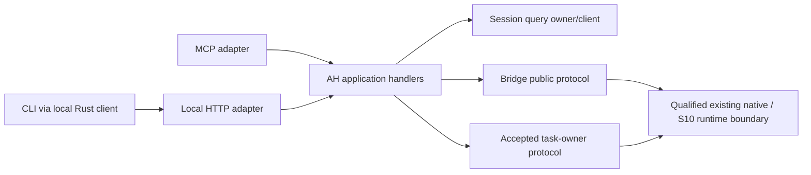

# AH: Shared Rust application server

Date: 2026-11-04. Revision: 1. Status: implementation proposal; no builder launched.

The user assigned this session AH exploration, an implementation plan and a
budgeted first slice. AH now belongs to `ah-server-root`, session
`01a1a862-034f-7750-b86b-de29e11cf327`. This replaces only the reviewed plan's
proposed backend-integration allocation for AH. Backend, UI/CLI and S10 keep
their current scopes, grants and deadlines. Chatboard notices 4396 and 4397
record the ownership change without rewriting reviewed history.

The architectural baseline is
[the connector plan](connector-adapter-architecture-plan-20261104.md), specifically
**Shared Rust application server** and package **AH**, at commit
`d86df598f8d140003c9ae2a803b2b7af79c759f5`. Its SHA-256 is
`026fca8e02c317fa60997d20a04c71625f006e8194aad00584a751e634765da9`.
The [revision-4 review](../reviews/connector-adapter-architecture-20261104/r4/report.json)
accepted that plan with no blocking findings. This implementation proposal has
author assessment only; the prior review does not review these new bytes.

## Proposed realization

Add `rust/crates/work-engine-server`: a thin executable with application,
startup/configuration, MCP, local HTTP and process-lifecycle modules. Application
handlers consume public domain clients. Transport parsing does not decide
admission, approval, visibility, accounting or runtime settlement.

Use the existing session-owned query client for session queries. Keep public
query/result meaning with that owner; an AH transport envelope carries version,
correlation and server-source attribution without replacing domain DTOs or
historical codecs. Add a small local Rust client with the server package first;
extract a separate client package only when a separately built consumer needs
it. Clients receive no writable store or private permit dependency.

The task and runtime arrows describe later enabled capabilities. The first
slice enables session list/read only. A module or dependency's presence does
not establish its operation as ready or admitted.

Trusted startup selects the operation allowlist, profile versions, source and
executable pins, domain endpoints, local caller binding, listener addresses,
private configuration paths and resource limits. Requests cannot select a
helper, workspace root, database, executable or runtime profile. Invalid trust
configuration fails startup; an unavailable configured owner yields degraded
readiness and attributed unavailable responses. Liveness says the process is
running; readiness is per capability. Neither health nor a read starts a job.

The initial HTTP profile is local service-to-service access: numeric loopback
bind, a private operator credential supplied through a protected file or
descriptor, exact Host/port checks, no browser Origin/CORS allowance, JSON-only
bounded requests, bounded connections/output and explicit deadlines. MCP stdio
inherits the same trusted operator profile. These are connections for one
operator, not separately installed clients. No public bind, OAuth issuance or
multi-client policy is inferred; A2 remains the owner of those requirements.
The Web mailbox/sync process can later be an HTTP client without exposing the
laptop directly to a browser.

The local wire proposal is `POST /v1/session-queries`, carrying a versioned
operation and its domain arguments, plus separate liveness/readiness reads.
MCP `tools/call` translates the enabled tool names to those same handlers.
Freeze exact schemas, error mapping and MCP version at slice admission after
binding the query owner's final contract. Preserve owner errors and payloads;
server transport failure and owner unavailability remain distinguishable.
Server build/config identity and response time are not substitutes for an
owner's source revision or observation time.

## What exploration established

| Input | Observed standing and consequence |
| --- | --- |
| Current MCP query/composition owner | `session_events.Server.call_tool` dynamically dispatches queries. `bridge_call` invokes the pinned Rust bridge and adds `bridge_observation` workers, usage, closure and result evidence. A raw bridge DTO would lose supported query meaning. AH consumes this through the query owner's public client. |
| Current local HTTP protection | `make_http_handler` checks loopback Host, rejects Origin, bounds JSON input and separates its auth profile. The AH local profile preserves those relevant protections and adds its explicit operator binding; it does not inherit the legacy public-query policy for a shared remote endpoint. |
| Active CLI/query increment | Private checkpoint `1b91a932ee24d7ad14dbf23061cab061c6a75be1` exports `session_query::query` and a `work-engine-query` binary. The client delegates to pinned unchanged Python owner SHA `e4ceb6d7f5f7685f8c9c0ad84ce7ddd54fd1dc6bae8cc71f35be86373e53c716`. Root accepted list/read feasibility at 21:03 UTC. Final security, enriched parity and independent source acceptance are pending in that checkpoint's record. Do not consume the changing worktree as an accepted release. |
| Legacy bridge | Existing submit/read/reconcile logic owns durable operation identity, exact retry and unknown native entry. AH can consume its public protocol; it must not reproduce its journal or native-send loop. A new bridge public-client extraction, if needed, belongs in an explicitly scoped domain contribution. |
| S10 host component | The shared working tree includes the accepted bounded provider-disabled Pi/Docker component; its `Host::run` persists create/start uncertainty and refuses replay. Its journal is custody evidence. This is not the later coding profile or an application server. |
| S10 coding source | The accepted private source-integration candidate is `/home/bline/.local/state/work-engine/s10-rust-integration-20261104T1842/ROOT-RESULT.json`, manifest `496a28ff4566d2e0e2be09a573d765362e5dd20e84e8556bd414e3dc0f04fe18`. Its source acceptance and the separate real-coding qualification have different subjects. Neither establishes a new MCP/Pi gate. |
| Backend signed-Pi join | Backend's current fixture/review remains its own work. AH receives a later exact interface/profile handoff; it neither imports a partial candidate silently nor requests changes under that grant. |

The query owner's temporary Python delegation already has a real consumer and
an A3 removal owner. AH reuses that one boundary; it does not add another Python
compositor or make migration of all observation/delivery code an AH dependency.

Restart discovery of pending domain operations is not yet bound to a public
contract in this proposal. Before enabling writes, bind either the owner's
recovery enumeration or its supported exact-operation recovery mechanism and
required trusted references. If the existing API cannot establish the required
recovery claim, obtain a scoped owner contribution. Server metadata cannot
become a substitute admission ledger, and lack of that API cannot be presented
as completed recovery.

## Implementation sequence

| Slice | Outcome and acceptance | Inputs / estimate, not a grant |
| --- | --- | --- |
| **AH1: Running query composition** | A pinned Rust server serves actual fixture session list/read through MCP and local HTTP using one owner-bound application service. Include local Rust client, startup/readiness/drain and real-process tests. Disable MCP and repeat HTTP/client queries. Deliver frozen source, executable/config identity, custody and separate review. | Final accepted query-client handoff; proposed **$25 / 2 hours**, detailed below. |
| **AH2: Admitted operations and recovery** | Add the selected enriched operation/result and granted-input boundary. Domain owner checks exact grants. Prove concurrent exact retry, changed-payload conflict, refused/unknown results, lost acknowledgement, crash/restart and owner outage without a second native start. Drain reports unresolved owner dispositions and timeout truthfully. | Exact A1 command interface or scoped bridge public-client contribution; accepted domain/runtime profile. Approximately **$35–50 / 3 hours**, re-estimate against that handoff. No paid provider run in this estimate. |
| **AH3: Composed profile and release candidate** | Qualify actual MCP, HTTP and CLI access to the selected operations, Web/CLI with MCP disabled, owner outage/restart and exact release/configuration closure. Consume S10 only through the selected owner's admitted runtime boundary. Publish compatibility/handoff evidence for A4/A5. | Separately admitted CLI transport integration and domain/runtime handoffs; approximately **$20–30 / 2 hours**, re-estimate at admission. A2/A3 apply when those capabilities are enabled. |

The rough AH-only envelope is $80–105 and seven hours across these slices; only
AH1 is offered for admission now. This excludes domain migrations, A2 remote
policy, A3 delivery extraction, A4 Web presentation/signer work, A5 overall
connector conformance, actual provider charges, deployment and state migration.
These remain visible dependencies, not work assigned to peers by this plan.
AH's source/process acceptance and overall connector-plan acceptance remain
separate; the mandatory current/replacement Web proof still belongs in A4/A5.

## First slice: AH1 admission proposal

**Deliverable:** one production-intended Rust composition executable with two
actual adapters and a local Rust client, exercised only with disposable local
session fixtures. Support `list_sessions` and `read_session`; all other
application operations are explicitly disabled/unsupported for this profile.

Before launch, the root binds the query owner's accepted immutable handoff:
source commit/manifest, client API/wire version, helper/source closure, relevant
validation and remaining limits. The present early checkpoint is discovery
evidence, not that final handoff. If the handoff is unavailable, report the
dependency and do not spend an AH builder grant on repairing the peer's slice.
This makes source acceptance an explicit input rather than a hidden concurrent
import. Any source-use exception requires its own recorded decision.

Proposed ownership is one coherent builder leaf. The root owns AH architecture,
admission, source binding, coordination, collection and acceptance. The builder
owns only the new server crate, its tests/docs/fixtures, and necessary isolated
workspace manifest/lock changes. It is not alone in the repository and must
preserve other actors' edits. No bridge, S10, query-owner implementation or
UI/CLI presentation changes are assigned to it. An isolated worktree and
separate target prevent collisions with the shared dirty workspace and builds.

Proposed builder: fresh `gpt-6.1-terra`, `medium`, Fast/priority requested and
observed before work. Proposed reviewer: a separate top-level
`gpt-6-astra`, `high`, standard/default, with independently observed read-only
grant. This is same-provider/different-model review, not cross-provider evidence.
The reviewer sees the exact source, contracts and process evidence and stays
available for a bounded repair. No discovery coordinator or parallel builders
are needed. These are future selections; neither role has been launched.

| Allocation | Maximum planned dollars |
| --- | ---: |
| Builder and focused validation | 8 |
| Separate review | 5 |
| Repairs and recheck | 4 |
| Root binding, collection and acceptance | 6 |
| Closing/reporting reserve | 2 |
| **AH1 total** | **25** |

All amounts are API-equivalent dollars adjusted for observed subscription
speed, not measured subscription quota or a billing promise. Count every AH1
actor and attributable preparation/closure from admission. This planning pass
has its own earlier supervisor-proposed $10/45-minute cap and is reported
separately; it is not erased or charged again. No peer budget transfers.

The proposed first executable checkpoint is **45 minutes or $8 aggregate**,
whichever comes first, inside the same $25. It must show a built server and
the same owner-backed fixture query reached through actual MCP and HTTP,
with source/executable identity and collected process evidence. Stop new
dispatch if that consequence is unestablished; collect unfinished work and
present the cause and revised bid. Do not restart the clock or expand the
slice silently. Target productive completion by 90 minutes and use the last
30 minutes for collection/closure; **two hours is the hard overall limit**.

AH1 acceptance uses the actual composed process:

1. MCP initialization/discovery/tool invocation and the HTTP request reach the
   same handler and pinned query owner. At a fixed fixture revision, list/read
   payloads, errors and unavailable fields agree with the owner baseline.
2. With MCP disabled, HTTP and the local Rust client still work. Unknown
   operation/version/field, client-supplied profile and all mutation names
   refuse before an owner call. No health/query path reaches native execution.
3. Invalid trust configuration fails closed. A missing, changed or unavailable
   owner is capability-unavailable, never an empty healthy result. Liveness
   remains distinguishable from configured readiness. Credentials and private
   configuration do not appear in argv, payload echoes or logs.
4. Exercise bad Host, browser Origin, missing/wrong local credential, oversized
   or malformed input and request deadline. Failures are bounded and attributed;
   a production adapter cannot select the fixture failure implementation.
5. Shutdown stops admission first, collects owned listeners/requests/helpers,
   and exposes drain completion versus timeout/unresolved custody. Align the
   drain budget with the final query client's actual helper deadline; cancelling
   a Rust future is not evidence its blocking helper exited. Restart on the
   same fixtures rebinds the same configuration and owner without native entry.
6. Focused package tests, process fixtures, formatting and strict relevant
   Clippy pass on the frozen closure. Use custody records, exact input/output
   hashes and source-preservation checks. Separately review the resulting
   subject and repair blocking findings within the original limits.

AH1's read-only restart evidence does not establish admitted-operation crash
recovery. That proof remains AH2. A passing local HTTP fixture is not a Web UI
replacement, A2 remote authorization, S10 qualification or deployment.

## Coordination and evidence

The root listens to `all`, `aspect:application-server`, its direct session and
`role:ah-server-root`, plus the current query/backend/S10 topics. Bind selectors,
replay cursor, context source and collection route in the assignment record.
Read/replay before a dependency is frozen or paid work is dispatched. Notify
the exact peer when a dependency changes; a notice cannot expand that peer's
scope. Current assignment and collected observations live under
`/home/bline/.local/state/work-engine/ah-server-plan-20261104T2107/`.

This exploration used `repo-search` / Codebase Memory Tier 2 for orientation,
trace and implementation placement. Project `home-bline-code-work-engine`, root
`/home/bline/code/work-engine`, index `2026-11-04T21:02:13Z`, store
`u873cbb79126b08a4g2`. Exact queries/snippets covered the session query/HTTP
owner, bridge submit/reconcile and Pi/Docker run. Selected-path coverage for
ten source/config/plan/result paths returned no recorded issue, with content
verified and complete coverage pagination. This is best effort, not a complete
repository or runtime audit.

Some graph relationships resolved to frozen review copies or unrelated Rust
symbols. Those edges were not relied upon: direct exact source established
dynamic query dispatch and bridge owner behavior. Broad BM25 discovery was
candidate-only and was not exhausted; no absence or complete-impact claim is
made. External private checkpoints and state records were read directly because
they are outside this graph project. The S10 and CLI outcomes above are
attributed handbacks, not qualifications rerun by this session. No executable
build, provider request, deployment, source import or implementation occurred.
