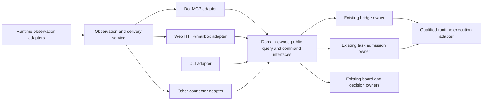

# Connector adapters around existing Work Engine owners

Date: 2026-11-04. Revision: 3.

Status: candidate implementation plan. This document proposes work; the user's
current instruction authorizes planning and an Astra high review. It does not
activate a connector, admit an engineering task, change OAuth policy, merge an
integration candidate, or deploy a service. Exact review subjects and decisions
live in [the review directory](../reviews/connector-adapter-architecture-20261104/).

## Outcome and scope

Make another user-facing connector possible without adding channel-specific
branches to session observation, command admission, approval verification, or
native execution. Make another runtime possible through a separately qualified
runtime implementation without changing each channel. These are two different
extension axes. Dot and the Web UI are both replaceable channel presentations;
their MCP and HTTP/mailbox transports are adapters to the same owned application
contracts. Neither current presentation is a required domain component.

The first delivered proof is a real non-MCP CLI channel, alongside the existing
MCP channel, using the same query and granted-input operations. Overall plan
acceptance also requires the Web path: its current and replacement presentations
must use public queries, projections and decision transport without depending on
Dot, MCP, or presentation-specific backend rules. A local HTTP connector fixture
proves authenticated remote ingress and event egress; it does not substitute for
the explicit Web replacement proof.
Actual Slack, Telegram, GitHub, or other account integration is a follow-on
selection, not an unspecified dependency of this plan.

New first-party executable/shared code follows the Rust direction. Existing
Python, JavaScript, deployed state, and signed formats retain their contracts
until their replacement or migration is accepted. This is not a rewrite of all
Work Engine subsystems, a new universal event bus, or a new lifecycle manager.

## Source baseline and current standing

The evidence snapshot and its source hashes are retained in
`reviews/connector-adapter-architecture-20261104/evidence/manifest.json`.

| Subject | Identity and standing |
| --- | --- |
| Work Engine checkout | HEAD `0d51c0b8668d2497c0f7b31d5aac9b169faa60b5`, with concurrent dirty work. Selected actual file bytes are the evidence baseline; HEAD alone is not their identity. |
| devwits-auth checkout | HEAD `119c8669c0d5bccd1acc613eeb14566a057132cc`; selected actual bytes are recorded separately. |
| Signed-task/Pi integration candidate | Private commit `0dc727766169cc0b4c8a2f587a176ffda1ce5d54` in `/home/bline/cbm-work/wt-dot-s10-coding-20261104`. Closed partial; not merged or deployed. |
| S10 Rust integration handback | `/home/bline/.local/state/work-engine/s10-rust-integration-20261104T1842/ROOT-RESULT.json`: accepted bounded source integration candidate; manifest `496a28ff4566d2e0e2be09a573d765362e5dd20e84e8556bd414e3dc0f04fe18`. This does not qualify a new MCP/Pi admission path. |
| Dot/OAuth handback | `/home/bline/.local/state/work-engine/dot-s10-coding-integration-20261104T1754/RESULT.json`, board #4368: offline_access consent and a Dot status call observed; refresh after expiry untested. Signed Pi authority hooks, pre-access sealing, coding MCP composition and explicit Pi signing UI remain incomplete. |

The inspected system already has useful boundaries:

- `skills/session-events/scripts/session_events.py` owns the MCP projection,
  subscriptions and delivery machinery. Its daemon observes Codex/Claude
  transcripts, enriches observations, and emits signed webhooks with retained
  delivery/replay state. It is not the canonical task or decision store.
- `rust/crates/session-bridge` owns legacy granted-message admission and durable
  native-operation reconciliation. `native.rs` speaks Codex RPC directly.
- The private `session-task-admission` candidate owns typed request/proof,
  current-registry, admission/outbox and projection semantics. Its ordinary
  CLI/MCP path returns existing admissions or Held inspection; a general
  qualified production gate is not established. Its separate scoped native
  profile has its own exact authority contract. Neither is a generic Pi gate.
- `devwits-auth/laptop/approval_sync.py` projects board requests and optional
  task snapshots into the Redis mailbox and transports independently verified
  owner answers back. The Web UI polls that projection; it does not currently
  subscribe to MCP Events.
- Stytch issues identity/access credentials; browser sessions and Connected
  Apps access tokens have distinct validation contracts. `mcp-auth` validates
  resource access. Exact WebAuthn owner-answer proofs and local bridge/task
  grants establish different authority from login or a scope.
- The lifecycle provider already exposes `TextTurnPort`. Broader inference and
  lifecycle work belongs to its owners and the proposed post-S10 amendment;
  connector work cannot silently replace that contract.

These observations are source evidence, not claims that every assembled path is
live or qualified. The ordinary tunnel HTTP unit was observed without
`--auth-config`; a separately configured OAuth endpoint is a different profile.
Before implementation, rebind the selected source and actual endpoint rather
than treating either observation as a deployment-wide statement.

## Target boundaries

The diagram shows dependency boundaries, not one process or database. The Web
adapter can continue to use the mailbox and polling. Shared observation
contracts do not require it to implement MCP or receive inbound laptop traffic.

### Web presentation, transport and approval signer

Separate the Web presentation from its HTTP/mailbox/sync adapter and from the
approval-signing function. The adapter translates public operations and owned
projections; it has no special admission or decision authority. A different
presentation can use it, and another transport implementation can implement
the same contract. Replacing either must leave domain rules, identities and
owner stores unchanged. Existing Redis/polling can remain one realization;
forcing every client onto MCP or a new push transport is unnecessary.

A0 records supported operation/profile capabilities for each channel. For
operations supported by several channels, equal authorized inputs and the
same source revision produce equivalent owned meaning, including Held,
unknown, denied and unavailable. A snapshot may be older than a direct query;
its source revision, observation time and freshness remain visible rather than
being presented as a different current truth. Equal replaceability does not
require every surface to expose every capability. Unsupported actions stay
explicit; they cannot excuse omitting the Web's existing read, review and
signed-answer workflow from conformance.

Approval signing is a distinct required capability when the operation requires
an owner proof. A replacement presentation can delegate it to a separate
signing component or replace its presentation while preserving the existing
proof contract. The component must present the exact reviewable request and
produce the same verified signed-answer semantics; a chat click, browser login,
mailbox write or successful delivery cannot replace that proof. The current
WebAuthn keys are bound to the configured RP/origin. Moving the dashboard does
not authorize accepting signatures from another origin or changing trust pins;
a different signing trust binding needs its owning migration decision.

A4/A5 demonstrate both presentation substitution and transport substitution
using local browser/client fixtures: run the Web workflow without Dot/MCP,
replace the current presentation with a minimal alternative using only public
contracts, and substitute a local transport adapter for the mailbox path.
An explicit signing component may remain, but the replacement cannot depend
on the old dashboard or on old mailbox data as another authority. The proof
uses the actual signature verifiers with isolated fixture credentials/trust
pins and synthetic effects; it does not require real approvals, a new RP,
production Redis migration or live provider execution.

### Public operations and ownership

Begin with only operations that already have an actual consumer. Names below
describe proposed interfaces; they are not a commitment to a crate count or a
new generic dispatcher.

| Interface | Semantic owner | What an adapter does |
| --- | --- | --- |
| List/read session observations; preview matches | Session observation service | Translate inputs and render attributed observations within granted visibility. |
| Subscribe, replay, inspect delivery | Subscription/delivery owner | Translate the channel's subscription mechanism; keep recipient-specific delivery state. |
| Submit granted input; read exact operation/result | Existing session bridge | Pass the exact request and existing capability to the owning boundary; never implement a second admission journal. |
| Inspect typed task admission; read task projections | Existing task admission owner, once its source is accepted | Preserve Held and unknown results; do not construct a qualification permit or add execution as a side effect of extraction. |
| Transport an owner answer | Existing signed-answer and board consumers | Preserve exact signed bytes and independently check them where the owning action consumes them. |

The existing MCP operation/result reads are composed views: Python
`bridge_observation` adds worker, usage and process-closure observations to the
Rust bridge's operation state. The session observation owner owns that
composition through a public observation-query boundary. The bridge retains
admission/native state; the task owner retains its distinct typed task/result
projection. A0 captures both raw and enriched contracts. A1 shares the composed
query between MCP and CLI, including unknown/unavailable fields, rather than
having CLI return only raw bridge DTOs. It can delegate to the unchanged pinned
compositor temporarily for those actual consumers, with bounded A1 scope/cost
and removal in A3, or move that bounded composition to Rust immediately.
Either route has one composition owner and the same compatibility fixtures.

Adapters do not access writable owner databases, private permits, provider
credentials, coordinator credentials, or internal reducers. A reference in a
request is data; it does not become a grant through serialization. A bridge
capability remains checked by the bridge, and typed tasks retain their own
admission contract. Existing operation identities and unknown-entry recovery
remain with those owners.

Public DTOs and clients live with the domain that owns their meaning. Evaluate
small `session-observation-wire/client` and bridge public wire/client packages
under `rust/crates/`; export the task owner's existing public types after its
source standing is settled. Extend `work-engine-types` only for identities or
encodings genuinely shared by actual consumers. Do not place session/domain
contracts in `lifecycle-provider` merely because it already has a trait.

### Runtime observation versus execution

An observation source resolves its real native identity and exposes entries,
turn observations, source cursors/revisions, availability, and provenance.
Codex and Claude implementations absorb their transcript formats and discovery
rules. Their native identities need not have the same syntax. Do not fabricate
a Codex UUID or completion event for another runtime.

Execution remains a separate capability implemented through existing owners.
Factor the Codex native interaction behind the bridge's narrow internal port,
preserving its preflight, exact-message identity, entry fence, acknowledgement
and reconciliation requirements. This is not an instruction to replace the
lifecycle provider, create another tool loop, or expose generic arbitrary RPC.
Pi can use the boundary only after its actual admission/custody/authority hooks
are qualified; the allocation experiment alone is insufficient.

A1 includes the narrow internal Codex execution-port extraction and its existing
failure/reconciliation fixtures. A3 owns observation-source extraction. Additional
runtime execution implementations remain deferred to their existing owners;
channel acceptance does not qualify them.

Capabilities are versioned descriptions bound to a selected implementation and
qualified profile: observation, history, granted input, interruption, usage,
custody and closure evidence as applicable. The trusted operator/owner selects
implementations. Connector input cannot load code or assert its own profile.
Unsupported, unestablished and unavailable remain distinguishable. An adapter
cannot claim execution support from successful transcript parsing.

### Identity and visibility

At an ingress boundary, verify credentials and construct an internal caller
context containing owner identity, connector/client identity, installed
connector binding, granted application capabilities and visibility scope. The
installation binding comes from trusted configuration or independently
validated issuer data, never from an arbitrary request field. Owner and client
are distinct even when several connectors serve one owner.

Retain the existing Stytch issuance profiles and their subject, client,
resource/audience and key checks. A policy mapping may map verified claims and
trusted installation configuration to application capabilities. Proposed
capability names are not a claim that Stytch currently issues corresponding
custom scopes. Client registration, issuance changes, refresh, key rotation and
revocation each need their own supported provider evidence when exercised.

The current verifier returns allow/scope rather than a caller identity. A2
therefore needs a trusted verified-caller result from that same validation
boundary or a configuration binding with equivalent assurance. Downstream
parsing of unverified JWT claims cannot construct the caller context.

For the new multi-connector profile, protected queries, transcript reads,
subscription inspection and replay are authenticated and visibility-scoped.
Subscribe also requires permission for each source and destination; command
submission additionally requires the existing exact operation grant. Metadata
discovery can remain public. The current public replay allowlist is confined
to its existing endpoint/profile until an explicit policy migration is accepted;
it cannot be inherited by a new shared-connector endpoint accidentally.

Derive subscription ownership and keys from the verified caller binding. Scope
read, replay, refresh and unsubscribe alike. Decide explicitly whether several
clients serving one owner share a subscription; default to separate recipient
state. A fixed `principal="tunnel"` is retained only as a trusted legacy profile,
not treated as the identity of every newly authenticated client. Local CLI
access has an explicit operator profile; it is not an unauthenticated remote
backdoor. Tokens and capabilities are not command-line arguments or log data.

### Subscription authority during asynchronous delivery

For the new multi-connector profile, ingress authentication permits a request
to create or renew a separately recorded delivery grant. The trusted connector
authorization policy owner in A2 owns installation enablement, permitted source
and enrichment visibility, destination binding, policy revisions and grant
expiry. This is access policy, not another task/approval ledger. The delivery
owner stores the grant reference and required currentness evidence alongside
the subscription; a bare principal string and subscription TTL are insufficient.

Choose an explicit grant expiry within the trusted policy's bound. A delivery
grant may outlive the access token used to create it only when that policy
expressly permits that lifetime. An expired token cannot renew it. Installation
disablement, grant revocation, source/enrichment access removal or destination
invalidation fences affected subsequent observation and disclosure, even when
the grant has not expired. This contract concerns the trusted policy owner;
immediate upstream OAuth-token revocation is not claimed without a supported
issuer signal and its own freshness contract.

Before collecting new protected observations and before every callback send or
retry, the delivery owner establishes that the grant is unexpired and its
installation/source/destination policy is current. Missing, stale or unreadable
policy holds affected work. The authorization-to-disclose boundary is ordered
with policy invalidation: an invalidation committed before disclosure entry
prevents that entry. A2/A3 select and test the local fencing mechanism rather
than assuming a prior ingress check or an unlocked check-then-send suffices.
Already-entered sends retain their actual acknowledged or uncertain outcome;
revocation is never described as recalling bytes already disclosed.

Persist accepted policy/grant revisions and invalidation through restart;
rollback to an older revision cannot restore access. Renewal revalidates the
current binding and reduced scope and cannot resurrect an invalidated grant.
It needs a new authorized grant if access is later restored. A retained payload
that exceeds the current grant is suppressed as a whole, with its original
bytes and delivery disposition kept under the declared retention policy.
Re-signing or silently trimming it is not a retry of the same payload. Retained
payload reads/replay also check current visibility, including enrichment
dependencies, rather than relying only on subscription ownership. This does
not require an online issuer lookup for every event or completion of OAuth
refresh work before local policy fencing can be demonstrated.

### Event and projection compatibility

Keep a small versioned observation envelope with event identity/type, semantic
schema, subject, source and observed times, producer/source revision, correlation
references, and availability/provenance. Payloads remain owned by the producing
domain. Provider terminal status, worker outcome, accounting coverage, native
custody and process closure retain their separate meanings.

The relay owns delivery attempts, recipient cursors, retry/backoff, rate limits,
callback verification and replay retention. Each recipient has independent
progress. A callback acknowledgement is receipt by that endpoint; it does not
establish a successful task or permission to execute. Retries use stable
identity/payload, and consumers deduplicate. Uncertain native entry is reconciled
by its execution owner, never replayed because a notification was duplicated.

Capture the actual current event IDs, names, payloads, signing bytes, cursor
semantics and retention behavior as compatibility fixtures before moving code.
Keep v1 wire behavior where promised; introduce a negotiated/versioned envelope
where additional fields would violate an exact schema. Preserve original
`owner-answer/v1` strings, request digests and historical `dot.*` schema codecs.
Channel-neutral Rust names do not require rewriting those historical bytes.

The Web UI consumes projections and a supported profile-specific review model.
Generate cross-language schemas/fixtures from the owning public contract where
possible; retain independent action-time verification. Adding a qualified
profile adds explicit review support and required-term rendering. Merely
removing the current Codex/profile guard would weaken review and is not this
plan's extension mechanism. A third-party chat approval button can link to the
existing signing view; the chat click itself is not a replacement owner proof.

## Implementation sequence

These are proposed bounded packages, not a campaign launch or worker grants.
The eventual implementation owner may split a package at a coherent boundary.
Each admitted package binds actual affected source and dependency closures,
including private candidate ancestry, rather than applying this dated baseline
blindly. One integration owner collects cross-repository evidence.

| Package | Concrete deliverable and ownership | Dependency and completion evidence |
| --- | --- | --- |
| A0: Bind contracts and predecessor standing | Integration owner records the exact main/dirty/private inputs, accepted predecessor portions, endpoint profiles, raw/enriched wire fixtures, composition and domain owners, compatibility commitments, and supported channel/profile operations including the Web read/review/signed-answer baseline. Rejects unsupported claims of Pi execution or OAuth refresh. | Planning can proceed from the pinned evidence now. Importing private source, moving state or changing a deployed release remains a separately owned integration decision. Complete when later packages have exact inputs and no ambiguous semantic owner. |
| A1: First shared operation and CLI | Bridge owner exports narrow public request/result DTOs, extracts its internal Codex execution port, and exposes existing granted-input behavior. Observation owner exposes the shared enriched operation/result query. MCP adapter and a new Rust CLI use those same boundaries. Include existing read-only typed inspection only if the task candidate is accepted; it remains Held where it was Held. | A0. Provider-disabled exact fixtures demonstrate the same request identity, composed result and refusal through MCP and CLI, including missing worker/usage/closure evidence. Exact retry returns the same operation; changed payload conflicts; a lost native ACK stays unknown with no second send. No new remote exposure. |
| A2: Connector identity and scoped ingress | Auth/delivery owners establish trusted connector-policy ownership, verified caller/installation binding, operation/visibility checks, and persisted delivery-grant lifetime/invalidation. Keep old token issuance and legacy endpoints explicitly separated. | A0; complete before adding remote clients to a shared endpoint. Two test client bindings under one owner cannot read or mutate each other's subscriptions/replay. Wrong owner/client/audience, expired credentials, forbidden targets/destinations and stale policy are rejected or held at the owning boundaries. |
| A3: Observation sources and delivery composition | Observation owner extracts Codex and Claude source implementations and isolates source-neutral filtering/enrichment/delivery. Reuse existing delivery mechanics while enforcing the new profile's grant checks at observation/send/retry boundaries, ordered with invalidation. Port bounded mechanics to Rust as their owner is replaced; remove any temporary A1 compositor delegation. | A0, public query contracts, A2 for shared remote access. Replay real redacted transcript fixtures, partial lines, rotation/replacement, daemon restart, outage and independent-recipient progress. Compatibility and unknown-state results match the selected old profile; new-profile invalidation survives restart and does not rewrite retained payloads. Split parsing and delivery if one package cannot establish both coherently. |
| A4: Replaceable Web channel and profile review | Observation/task/approval owners publish the shared query, projection and review/answer contracts; the devwits-auth owner separates presentation, transport and signer dependencies. Both the current Web presentation and a minimal replacement consume those contracts. Demonstrate an alternative local transport adapter without changing domain owners. Preserve pinned-key and action-time checks; existing polling can remain. | A0/A1 public contracts and existing board/approval contracts; accepted task-owner source for the typed profiles claimed. Web query/board conformance can proceed without a new Pi gate or full event push. Browser/client fixtures and Rust/JavaScript vectors establish exact terms, request/answer bytes, source revisions, denied/unknown outcomes, wrong-origin/key rejection and equivalent owner decisions. Unknown profiles and missing terms hold approval visibly. Pi-specific review support still waits for its qualified contract. |
| A5: Connector conformance and release candidate | Integration owner exercises MCP, CLI and the mandatory Web path, including replacement presentation and transport fixtures, plus the local non-MCP HTTP connector fixture. Prepare one exact release/configuration candidate and state migration/import disposition. | A1-A4 for the selected existing profiles. A Web-omitting A1-A3 result is bounded partial work, not overall plan completion. The fixture uses two installations, restart/replay and denied-authority cases. It covers a queued retry after access removal, installation disablement, source/enrichment/destination grant invalidation, expiry and stale policy, restart after invalidation and renewal after scope reduction. Source readiness and live qualification are separate results. A later selected real connector requires its actual ingress/auth/callback checks before activation. |

An additional runtime execution profile is not necessary to prove channel
extensibility. After these interfaces are demonstrated, the existing Pi/S10 or
lifecycle owner can implement the required runtime capability against them.
Its unresolved admission, current-authority, credential projection, isolation,
custody, accounting and closure obligations stay explicit and are not folded
into a generic adapter success claim. Broader direct Responses inference
remains with the post-S10 amendment owner.

Implementation assignments should follow current model-selection guidance:
bounded packages with settled contracts are suitable for Terra medium; reopen
architectural/authority decisions with the design owner rather than assigning
an unresolved contract to a builder implicitly. Independent review and the
actual package estimate are selected at admission. This plan does not allocate
an unbounded implementation budget or require parallel builders.

## Acceptance and failure evidence

The composed release candidate must establish these consequences at its stated
profile boundary:

1. A new channel invokes supported operations through public contracts without
   changing admission rules, provider logic, decision meaning or owner stores.
2. Codex and Claude observation sources produce attributed observations with
   their native limitations; adding a source does not require channel edits.
3. Equivalent MCP and CLI requests reach the same owner semantics. Read-only
   inspection and denied capabilities cannot acquire side effects in a wrapper.
   The Web path is mandatory: shared operations agree at the same source
   revision and equivalent authorized scope, with snapshot age visible. With
   Dot/MCP absent, both current and replacement Web presentations can read
   supported observations, review exact terms and transport signed answers
   through public contracts. Switching the presentation or local transport
   adapter does not change admission/decision rules or create another store.
   A required signer remains explicit and independently verifiable; replacing
   the UI never waives RP/origin, pinned-key, currentness or replay checks.
4. Duplicate delivery, concurrent exact submissions, a crash before/after
   durable intent and lost native acknowledgements do not duplicate execution.
   Unknown entry/custody/usage remain unknown until the owner establishes more.
5. Two connector installations are isolated for session visibility,
   subscriptions, replay and credentials. Callback verification, public HTTPS
   destination checks, redaction and bounded payload behavior remain effective.
   Unexpired delivery grants do not bypass current policy: an earlier committed
   invalidation fences later disclosure and retries, including across restart.
   Reduced-scope renewal cannot expose retained payloads outside current access.
6. A signed decision retains exact bytes, request/profile/actor binding,
   currentness and replay protections. Revocation committed before the effect
   is consumed prevents that effect under the owning contract; later
   observations do not fabricate rollback of an effect already entered.
7. Historical codecs, event cursors, retained deliveries, operation/grant state
   and pending owner interaction have an explicit accepted import or archive
   disposition. New projections are not a second authoritative store.

Use focused domain tests, cross-language golden vectors, protocol fixtures and
crash/restart tests for those claims. Then exercise actual service composition
with a separately approved harmless exact operation and selected auth profile
where the intended release requires live evidence. Synthetic token fixtures
cannot establish Stytch issuance/refresh; a fixture runtime cannot establish
actual provider execution or OS confinement. No broad benchmark or universal
adapter certification is a prerequisite.

## Integration and cutover

Preserve concurrent source and private evidence. Use isolated candidates, and
coordinate actual source integration with the existing Dot/Pi and S10 owners.
Do not merge their partial checkpoint merely to make the adapter plan appear
complete. A1 can wrap the existing bridge independently of typed Pi execution.

Revision 3 strengthens overall Web conformance. Existing work admitted against
revision 2 or a narrower A0/A1 packet retains its exact accepted scope; this
amendment does not retroactively add implementation obligations to those
actors. Such work can be accepted as its bounded portion while mandatory A4
and the composed A5 proof remain visible before overall plan completion.

Offline replacement is allowed by the Rust direction; continuous availability
and dual running are not prerequisites. The selected cutover needs one named
writer for each durable store, compatible readers or an explicit state
migration, preservation of unresolved work, and evidence for the configured
endpoint. Freeze/drain or fence old admission before another writer is enabled.
An old executable is not a safe rollback if new durable state or uncertain
effects are incompatible with it. Reconcile or retain the new owner until a
compatible recovery path is established.

The next implementation decision is admission of A0/A1 with an exact owner,
source baseline, acceptance scope and estimate. Acceptance of this plan by a
reviewer establishes review of this candidate only; it is not human acceptance
of implementation, state migration, third-party installation or deployment.

## Evidence method and limits

Repository intent: orientation, trace and impact; Tier 2 verification.
Work Engine graph project `home-bline-code-work-engine`, index generation
`2026-11-04T18:04:20Z`, store generation `uf26ca0b8169e9032g2` for the initial
traces. Final selected-path coverage was refreshed at index generation
`2026-11-04T19:35:17Z`, store generation `ua0d1dfc6a4d4a38ag2`.
Relevant targeted symbol results/snippets and bridge call directions were
checked; the relied-on in-project paths have no recorded coverage gap.
Best-effort clean coverage is not proof of completeness or runtime behavior.

devwits-auth and the private integration checkpoint are outside that graph
project. Their named files were read directly; private candidate bytes are
read from exact Git commit `0dc727766169cc0b4c8a2f587a176ffda1ce5d54`.
The evidence manifest records modes and digests. Handback outcomes are
attributed reports with their limits, not newly rerun qualifications.
No external provider requests, live execution, deployment or source mutation
were used to establish the architectural observations.
