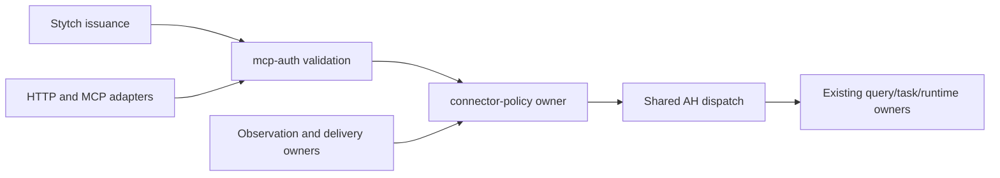

# A2 connector identity and scoped access design

Recorded 2026-11-05. Status: **design candidate for independent review; implementation and remote activation unapproved**. This refines A2 in [the connector plan](connector-adapter-architecture-plan-20261104.md). Auth/Web session `01a1a7ed-45f5-7041-9db5-a6c9aa1cd3f3` owns this design under the approved $10 / 75-minute design-and-Astra-high-review budget. It grants no work under another session's allowance.

## Outcome and evidence baseline

A connector's valid OAuth token identifies a caller; application policy determines which installation, operations, resources and disclosures that caller may use. Two clients of one owner must remain distinct. Revocation must stop subsequent protected collection and disclosure, including queued retries after restart. OAuth login never substitutes for an exact owner decision, execution grant or runtime admission.

Source baseline is Work Engine `839b8c4ee9f2c5f83d4b5ba342997021f29b8f35` and devwits-auth `285638858097d656797709fb376aecc41d5b0240`. The former includes merged AH2-T; the latter includes accepted A4.2. A4.2's actual runtime proof is pinned to owner42c72e11 / private AH subjectd672d928 and binary7e455d11, not a qualification of every later merged runtime.

| Current boundary | Source-backed standing | Consequence for A2 |
| --- | --- | --- |
| Rust `mcp-auth` | `rust/crates/mcp-auth/src/main.rs:63-204` checks signature/key snapshot, issuer, subject, resource audience, time, token type, client/project binding for the explicit Stytch profile, and scope; stdout is only allow/scope/invalid. | Reuse that validation and expose its verified identity; do not decode unverified JWT claims downstream or fork another verifier. |
| Existing HTTP MCP edge | `skills/session-events/scripts/session_events.py:3178-3370`, `HttpAuth.authorize`/handler, invokes the verifier but passes no verified caller to `Server.handle`. The selected legacy public allowlist and staging restrictions are separate profiles. | A successful Boolean cannot establish a per-installation caller. Legacy public replay is not a default for a new connector endpoint. |
| Legacy subscription owner | Same file, `Server._own`, `_key`, `subscribe` around2850-3001, uses the startup principal and callback/filter key. Default principal is tunnel. `Daemon._deliver` around3660-3706 reads source lines and title enrichment before delivery attempts. | Preserve existing profile meanings; add installation visibility checks before both collection/enrichment and disclosure in the new profile. |
| Existing Rust delivery owner | `rust/crates/session-delivery/src/lib.rs:40-110,492-571` has recipient/principal/generation bindings and prepared/unknown attempt states. `DeliveryHelper` around2443-2542 explicitly requires a fixture-only native delivery configuration. | Reuse actual delivery identity/attempt ownership where applicable; this is not an already qualified generic OAuth webhook engine. |
| Shared AH | `rust/crates/work-engine-server/src/main.rs:449-582` accepts a local private bearer credential, rejects Origin, and serves its JSON operation endpoint. MCP is a separate stdio dispatcher. | Remote OAuth or HTTP MCP support cannot be inferred from local HTTP or stdio support. Their new authentication adapters need explicit composition evidence. |
| Web session and mailbox | devwits-auth `api/_lib.js:34-130` distinguishes a Stytch session JWT for the fixed owner from the laptop mailbox bearer; A4.2 adds a separate local AH credential profile. | Neither browser session nor mailbox/AH credential becomes a remote connector token by reinterpretation. |

These are bounded current-source observations, not exhaustive absence claims. Graph project `home-bline-code-work-engine`, generation2026-11-05T14:54:37Z, supplied symbols and relevant traces; coverage has unresolved calls in the material Python/Rust files. Exact source reads governed those regions. The devwits-auth path is outside that index and was read directly. The checked-in source is pinned before review; dirty context-guidance files and peer runtime/CLI work are outside this design.

Stytch remains the authorization server for its selected Connected Apps profile. Its [MCP example](https://stytch.com/blog/building-an-mcp-server-oauth-cloudflare-workers/) distinguishes browser sessions and OAuth access tokens; its [authorization guide](https://stytch.com/blog/MCP-authentication-and-authorization-guide/) describes resource-server validation and scoped access. These primary references support the role separation, not the actual test project's token template, resource audience, custom scopes, refresh or revocation latency. `skills/session-events/HTTP-OAUTH.md` retains the project's stricter issuance prerequisites and token-type separation caveat. No provider call or configuration change is part of this design.

## Ownership and application boundary

`mcp-auth` remains the cryptographic/token-profile owner. The proposed Rust `connector-policy` package owns application installation policy, capability/visibility decisions, delivery-grant lifetime, policy revisions and invalidation. AH composes that owner with existing domains. Query/task/approval/runtime owners keep their authorization and state machines. Delivery owners keep event bytes, queues, attempt identity, acknowledgements, retries, uncertain outcomes and retention. Policy grants are access authority, not another task or approval ledger.

The smallest initial Rust boundary is an extraction of the existing verifier into a reusable checked library, retaining its CLI outputs and existing profile tests. New internal identity types have private construction by that verifier. For the new profile, a verified issuer identity is not yet an allowed client or installation: the policy owner checks its signed client ID against the current registry. The legacy single-client CLI still enforces its exact expected client. No unverified routing hint can select a weaker issuer/token profile. Separate public wire records are versioned data, not deserializable authority permits. HTTP/MCP adapters decode credentials and request framing, then call the same checked authorization/application path; transport-specific operation names cannot bypass it.

### Verified identity, installation binding and capabilities

The verified issuer result contains the selected authentication profile, issuer/project realm, subject, signed client ID, validated resource audiences, token identifier, issued/not-before/expiry times, verified scope set and key/snapshot provenance. Tokens and raw Authorization headers never enter CLI arguments, logs or policy records. Audit correlation may use bounded non-secret references/digests. Issuer/profile/key/time failures are authentication failures; a valid identity without application permission is forbidden, not an empty healthy result.

The trusted policy registry maps `(issuer, project, subject, client_id, resource)` to an opaque installation ID and immutable binding generation. A first profile permits **one enabled installation for each such tuple**. Two installations under one owner use distinct qualified client IDs. An ordinary bearer token with identical owner/client/audience claims cannot distinguish two installations of the same client. That case is held as ambiguous until independently validated issuer installation data or an accepted installation-bound proof-of-possession profile exists. Request headers, callback URLs, display names, caller-selected installation IDs and unverified JWT claims are not substitutes. Duplicate binding matches fail closed.

Capabilities are an explicit intersection of verified OAuth scopes, trusted per-profile scope mapping, installation policy and resource visibility. Proposed application capability names do not assert that Stytch currently issues matching scopes. OpenID login is not an implicit read/write grant. Unknown mappings, token classes or owner/client/resource bindings deny or hold. No decision may switch to a less restrictive issuer profile on failure.

The application caller context binds verified owner/client/installation, binding generation, authentication profile, token expiry and applicable policy revision. Call arguments cannot construct or replace it. Subject identifiers remain namespaced by issuer/project; matching a bare user string across realms is insufficient. Each protected operation obtains a current decision for exact operation, resource IDs and permitted field/enrichment categories before its owner is invoked. A token authorizing reads cannot authorize task submission; command/answer paths additionally require the existing exact signed decision and operation grant at their consuming owner.

## Policy state, administration and profiles

Policy state records immutable installation identities/bindings, enabled state, monotonically advancing generations, allowed operations, explicit resource references, enrichment visibility, approved destinations and their revisions, grant limits/expiry, revoked-grant tombstones and operation identity. Registered resources/destinations come from trusted administration. A client may request a subset, not install a destination, choose a filesystem path, broaden selectors or mint its own grant.

The initial persistence choice is the **existing opaque durable-state CAS owner**, with `connector-policy` retaining payload meaning. Its stable key/current revision, retained predecessors and integrity checks avoid a second policy database claiming current authority. A small bounded Rust binding to the existing public adapter is part of the first bid; a generic storage rewrite is not. There is no assumed existing Rust durable-state crate. Any initial reuse of the existing helper is explicitly pinned, bounded and confined to this consumer, with replacement by an accepted equivalent Rust binding rather than a second permanent authority. An inability to consume its public CAS contract is a first-checkpoint blocker.

Only policy-owner semantic operations can mutate the value; an arbitrary whole-state replacement/import is not exposed. Mutators compare the current opaque revision, preserve tombstones, reject generation rollback and use stable operation IDs. A lost publication acknowledgement is reconciled by current/history reads and operation identity, never inferred from subprocess exit or retried as a new grant. Missing/corrupt state or a cache older than the canonical head holds affected work. Historical values are observations, not active authority. Force-moving/deleting canonical private refs or restoring the entire trusted control repository is outside the ordinary profile and requires explicit recovery; the store cannot prove protection from its own authority being destroyed.

The first deployment profile is cooperative local Linux with one trusted policy namespace and cross-process access to the same canonical state and stable lock namespace. Horizontal/distributed policy replicas are not silently qualified. Initial administration is a protected local operator interface for the owner of this namespace; remote self-registration, issuer administration and a management UI are separate contributions. Installation disablement and grant revocation are scoped, idempotent owner operations, not edits to credentials made by a client.

Existing `rfc9068-v1`, `stytch-connected-apps-v1`, staging, local operator, Web session and mailbox profiles retain their meanings. A new explicitly selected connector profile gets a distinct resource/audience configuration and no fallback to legacy dispatch. Metadata discovery may be anonymous; protected readiness, listings, object reads, replay and mutations require the new binding. Unsupported operations remain unavailable. Startup cannot claim a positive readiness property merely because the policy parsed or an unrelated query is healthy.

Before a real activation, inventory overlapping legacy access to the selected resources. A source still exposed by a legacy public route cannot simultaneously be claimed confidential solely because the new route is scoped. First qualification uses distinct private fixture resources; a production migration must remove, restrict or explicitly classify overlapping legacy exposure. Disabling one new installation does not claim to revoke another independent legacy credential.

## Common enforcement contract

| Boundary | Required consequence |
| --- | --- |
| HTTP request and MCP call | The same verified binding and application decision govern equivalent operations; path, method, transport and supplied metadata cannot change owner/client/installation. |
| Resource resolution, enumeration and transcript read | Denial occurs before protected collection. Do not enumerate/read everything and rely solely on filtering the final response. Unknown and forbidden resource IDs do not become an existence oracle. |
| Subscription create, inspect, renew, unsubscribe, status and replay | Ownership/cursors/recipient state derive from verified binding, including client and installation generation. An installation cannot address another installation's state even under the same owner. |
| Observation and enrichment | Exact source and enrichment visibility are current before protected data is collected. Unknown dependencies hold. Access to an event selector is not access to every title, transcript, budget or attached artifact. |
| Response/callback disclosure and every retry | Current grant, policy, destination and complete payload dependencies are checked at the effect owner's disclosure admission boundary, ordered with invalidation. An earlier ingress check is insufficient. |
| Signed answers/commands | Access authorization is necessary but cannot replace exact bytes, key/current-request checks, domain actor/grant validation or execution admission. |

A narrow first operation can be an explicitly allowed `read_session` over registered resource IDs. Broad listing, budget/reconciliation reads and other operations remain disabled until their visibility and effects are specified. Every operation added later needs its actual resource/enrichment dependencies; names or an OAuth scope string alone are insufficient.

### Delivery grants and revocation ordering

Creating/renewing a subscription validates its current binding and records a delivery-grant reference in the delivery owner's subscription. The policy owner retains the grant's installation generation, permitted source/enrichment set, immutable destination revision, policy revision, issuance provenance and expiry. Initial grants expire no later than the verified access token and configured policy limit; no refresh token is stored in a subscription and there is no autonomous renewal. An expired token cannot renew. A later profile allowing grants to outlive access tokens requires a separately accepted policy and evidence.

The contract requires ordering, not a particular locking implementation: invalidation committed before a protected collection/disclosure admission prevents that entry. A first bounded realization uses a stable per-installation cross-process guard shared by policy administration and the **actual effect owner**, reads the current CAS state under that guard, validates exact payload/destination/time and enters the protected operation before releasing it. Holding the guard for a bounded callback I/O attempt is a simple starting choice, not doctrine. Guard timeout reports unresolved/unavailable; it cannot acknowledge effective revocation before invalidation commits. Other installations retain independent progress. Binding changes use the affected installation guard and current CAS generation as well.

Returning a Boolean/serializable permit to legacy code for later unlocked sending does not implement this contract. A protected read result must also remain inside the application/transport owner until its response-disclosure gate; returning raw private data to an adapter that later writes it without the guard leaves the same race. The new-profile observation/response/callback effect must be behind the guarded Rust owner interface, or remain held. A2 supplies policy semantics; the actual observation/delivery owner must accept and qualify its integration. Existing Python webhook callbacks and fixture-only native delivery are not evidence that this new guarded callback profile already exists.

Already-entered sends retain their actual receipt or uncertain outcome. A revocation receipt states the committed cutoff/revision and outstanding admitted attempts; it does not recall bytes already released or prove when a remote endpoint received them. A pending retry is a new disclosure admission, so old authorization never permits it after invalidation. Crash after send intent but before a known outcome stays uncertain; revoked or expired authority never resumes it automatically. Persisted policy/grant revisions, tombstones and attempt references survive restart. Wall-clock rollback or an unavailable trustworthy time bound holds rather than extending a grant.

Renewal uses current policy and reduced scope and never reactivates an invalidated grant. Restored access creates a new grant identity. A retained payload outside current authority is suppressed as a whole; it is neither silently trimmed/re-signed nor retagged to a successor installation/grant. Replay and retained-payload reads check current visibility including enrichment. Policy revocation and upstream OAuth consent/token revocation are separate facts: offline JWT verification cannot establish an immediate upstream revocation signal. Integrating such a signal needs its supported source and freshness/latency contract.

## Qualification matrix

The implementation evidence must bind exact source/build/profile and disposable state, not merely return-shaped fixtures.

| Case | Required observation |
| --- | --- |
| Two signed client tokens, one owner, installations A/B | A reads only its registered resource; B cannot read A, inspect/unsubscribe its subscription or replay its events. Same client with ambiguous installation is refused. |
| Credential/profile faults | Wrong signature/key/issuer/project/resource/client, expired/not-yet-valid token, unknown scope mapping and substituted browser/ID token fail at their owning boundary. Equal token bytes cannot be distinguished by an unverified label; issuance separation remains a prerequisite. |
| Equivalent HTTP/MCP operations | Same caller/resources/outcome through actual selected adapters and owner; caller fields/cursors cannot replace context. Protected data remains protected with the legacy public allowlist present. |
| Deny before collection | Instrumented protected source/enrichment is not opened for a denied caller. Error bodies/counts do not expose forbidden object existence or payload. |
| Invalidate before queued retry | Invalidation commits, process restarts, queued old payload remains unchanged but no observation or callback entry occurs; no new grant silently inherits it. |
| Invalidate racing callback/response | Force both serial orderings. Pre-fence admitted I/O retains truthful receipt/uncertainty; invalidation before admission prevents it. Crash/timeout never becomes an effective-revocation or delivered claim. |
| Scope/destination reduction, disable/expiry, restore | Current/new grants obey reduced rights; stale generations and old cursors fail. New access does not resurrect tombstoned grants. |
| State/time faults | Stale CAS revision/import, missing state, restart, old cache, time rollback, lost CAS ACK and unknown network result hold or reconcile exact identity without duplicate effect. Force-restoring the canonical authority is explicitly outside the ordinary guarantee. |
| Recipient independence | One blocked callback or revoked installation cannot advance, erase or indefinitely block another installation's cursor/grant. |

Actual Stytch token issuance, refresh, rotation and upstream revocation require separately approved provider evidence for the selected project/client/resource. Synthetic signed JWTs and callbacks qualify local code paths only. A5 still owns the eventual joined release/configuration candidate.

## Implementation bid and stopping conditions

This $10 design slice implements none of the above. The following are **new proposed budgets**, not authorization or transfers of unused A4.2/design allowances.

**A2.1 immediate bid: $30 total / three hours**, including preparation, one coherent Rust builder, real adapter/owner tests, separate read-only Astra high review, repairs, coordination, commit and closure. Own `mcp-auth` extraction/checked identity, the new `connector-policy` owner and bounded durable-state binding, plus only the AH authentication/context/selected-read adapter seam. AH/query/domain semantic ownership remains unchanged; the future scope explicitly names that composition contribution rather than borrowing an old peer grant.

The accepted consequence is two installations with distinct synthetic signed client identities using one registered protected read through the actual selected HTTP and MCP adapters, with deny-before-owner-read, policy disable/restart/CAS and legacy-profile isolation proofs. Preserve existing local modes. The current AH has HTTP operation RPC and stdio MCP; adding a qualified OAuth MCP ingress is real adapter work, not assumed support. The proposed composition is a bounded new Rust HTTP MCP adapter over AH's existing MCP message dispatcher plus its operation RPC, both invoking the same verified caller/policy path. It is a separately selected fixture resource/profile; the current stdio/local credential profile is preserved. The implementation must bind the supported MCP framing/version to an actual SDK process test before claiming that adapter. A broader remote protocol, sessions/streaming feature or public activation is not implied. The first checkpoint confirms that exact composition and its owner interface. No unverified caller assertion forwarded by a privileged gateway is allowed. If it requires an extra authority service, an unaccepted domain interface or a broader protocol rewrite, stop and rebid rather than replace process evidence with a mock. Remote/public activation, subscriptions/callback enablement and signed execution are excluded from A2.1.

Allocation: builder/integration8, review6, repairs5, root binding/coordination6, closure5. First executable checkpoint is the earlier of30minutes or$6 aggregate including preparation: one verified identity maps to the intended installation and an actual protected read/denial reaches the real owner through the selected adapter path. Productive target is120minutes/$20; protect final60minutes/$10 for review/repair/collection. Hard stop is three hours/$30. No new dispatch after a failed checkpoint; collect and return the concrete mismatch.

**A2.2 follow-on estimate: $35 / three-and-a-half hours**, to qualify delivery grants, source/enrichment visibility, destination ownership, invalidation ordering, queued retry/replay and restart through the actual selected callback owner. It depends on accepted A2.1 and a delivery-owner guarded-effect interface; the existing native fixture is not that interface. Reconfirm this estimate against that handoff before seeking implementation approval. It includes bounded Rust adaptation of the selected existing callback mechanics, not a universal delivery rewrite. First checkpoint would establish both invalidation/disclosure race orders at the actual effect boundary before broader integration; otherwise stop. A3 retains source extraction and broader production delivery migration; A5 retains release conformance.

The staged implementation exposure is therefore65 proposed dollars, **plus** this separately approved10 design ceiling; none is hidden by reusing old budgets. Only A2.1 is an immediate fixed bid. The second estimate is conditional, and neither bid activates OAuth registration, credentials, refresh, production policy or deployment. A successful source slice may remain held for real activation until issuer/installation binding and overlapping-legacy migration evidence exist.
