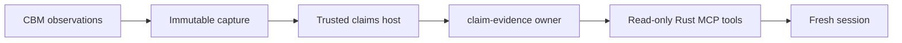

# CBM evidence for repository facts

This crate captures immutable repository evidence from a pinned CBM executable.
It records selected documentation/code bytes, exact tool arguments and responses,
publication identity, coverage information and limitations. A capture is evidence
for an attributed claim; verifying its digest does not verify the proposition.

`Binding` selects a stable repository ID, canonical checkout path, CBM project,
canonical executable path and executable SHA-256. Repository identity comes from
the trusted launcher. CBM project names and paths do not grant publication
authority. The capture checks the project's reported root between two matching
snapshot observations and requires that publication for all related results.

One native MCP stdio connection owns the capture. Supported observations are
`query_graph`, `search_graph`, `trace_path`, `get_code_snippet`, `search_code` and
`check_index_coverage` with `snapshot: true`, and `detect_changes` with
`scope: "doc_references"`. The adapter supplies the selected project and JSON
format. It rejects another project, unbound snapshots and publication changes.
Documentation pages follow advancing cursors; incomplete pagination stays
partial. Other bounded or partial results retain their original metadata.

The source paths in `CaptureRequest` are relative to the selected checkout.
Captured UTF-8 bytes and hashes are compared before and after observation;
filesystem access is confined to that checkout. Graph publication does not make
the live filesystem a transactional snapshot. Documentation references cover
indexed review candidates, including unresolved/unavailable rows, rather than
semantic impact or references removed from old documentation.

`publish_artifact` installs complete bytes atomically under their SHA-256 using
create-only custody. Existing identical bytes replay; different bytes conflict.
The artifact root must already exist. `read_artifact` checks scope and integrity
without creating or repairing files. `source_currency` compares only the listed
anchors with a selected current checkout; it reports `bytes_match`,
`bytes_changed` or `unavailable`, with applicability `not_assessed`.
Historical reads select the stable repository ID and artifact custody; a later
CBM project rename or checkout relocation does not change their authorization.
Each capture still validates its own project, root and publication consistency.

The `repository-evidence-cbm` executable provides `capture`, `read` and
`currency` entries with `--binding FILE` and `--artifacts ROOT`. Capture also
takes `--request FILE`; reads take `--sha256 DIGEST`. The Rust `Binding` and
`CaptureRequest` types define their closed input formats. The artifact reference
fits claim-evidence's evidence-reference contract and names exact stored bytes.
Executable pins and launcher custody remain deployment responsibilities; these
records are not independent process attestation.

The first version supports one repository/project per capture, UTF-8 sources,
16 MiB artifacts, up to 4096 source anchors and 64 documentation pages, bounded tool requests and a
five-minute capture deadline. Runtime and descriptor confinement use Linux
interfaces. It closes its own frontend and preserves the shared daemon's other
sessions. It publishes no claims, admits no grants and performs no automatic
refresh, acceptance or downstream reopening.

The explicit local integration test in
[repository_facts.rs](../work-engine-server/tests/repository_facts.rs) uses the
real CBM, trusted native claims host and two fresh MCP clients. Its required
binary and private cache/runtime bindings are supplied by the qualification
launcher; it requires no model/provider job or production claim root.
